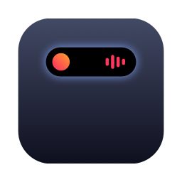
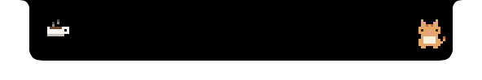
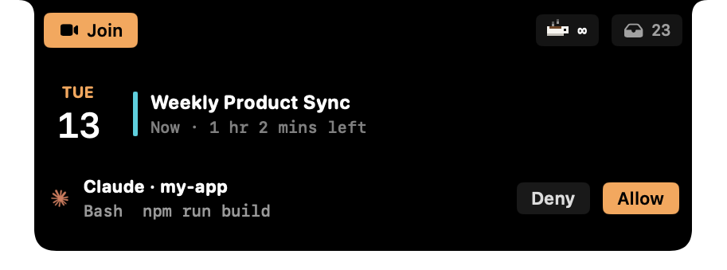

<p align="center"></p>

<h1 align="center">Peaky</h1>

<p align="center">A small, quiet Dynamic Island for your Mac's notch.<br>
Music, meetings, Claude Code, downloads, a file shelf, Keep Awake, and a pixel cat.</p>

<p align="center"><a href="https://github.com/iamsumanp/Peaky/releases/latest/download/Peaky.dmg"><b>⬇ Download Peaky.dmg</b></a> · macOS 14 Sonoma or later · Apple silicon</p>

---

<p align="center"></p>
<p align="center"></p>
<p align="center"></p>
<p align="center"></p>
<p align="center"></p>
<p align="center"></p>

## What it does

The notch stays a notch. Peaky only grows when there is something worth showing, and it opens when you hover over it.

- **Music.** Album art and live bars while anything plays: Spotify, Apple Music, YouTube in a browser, and so on. Hover to see the track and controls; click to open the full player. It goes away a minute after you pause.
- **Meetings.** From 15 minutes before a meeting starts, the notch shows the title on one side and the time on the other ("in 10 mins", "1 hr 2 mins left"). It has a **Join** button for Meet, Zoom, Teams, Webex, Jitsi, and Slack huddles. When a meeting ends, the next one shows up ("Next: Standup"). The menu-bar icon lists today's meetings, MeetingBar-style. Meetings you declined are hidden.
- **Claude Code.** You get "Finished", "Needs permission", and "Has a question" the moment they happen, labelled with the project name ("Claude · my-app"). Click the alert to jump back to that session's Terminal or iTerm tab, or its VS Code / Cursor window. In the Claude app you can also **Allow or Deny** a permission request right from the notch. Peaky stays quiet while you're already looking at the app the session runs in; if you switch away while Claude still needs you, the alert shows up then. See [Claude Code setup](#claude-code-setup).
- **Downloads.** While a browser downloads into `~/Downloads`, the notch shows the file name and percentage, then "Downloaded". Click it to see the file in Finder.
- **Shelf.** Drag files onto the notch to keep them close at hand. It works like Finder: scroll, ⌘A, click / ⇧ / ⌘-click, drag a box to select, Space for Quick Look, Delete removes (or the ✕ on a file), and dragging out copies the selection. Remove all with one button. Your files are never moved; the shelf only keeps references to them.
- **Keep Awake.** Caffeine, built in: keep the Mac (and optionally the display) awake indefinitely or for 15 min to 5 hours. A tiny pixel mug sits in the notch while it's on.
- **Volume / brightness.** A clean bar in the notch. Optionally, it replaces the system HUD.
- **Alerts.** One short popup for AirPods and other Bluetooth devices connecting, for charging, and for low battery.
- **Pet.** A pixel cat (or dog, or bunny) sits beside the notch when nothing else is going on. Off by default.
- **Any monitor.** On screens without a notch, Peaky draws a compact one. You choose which displays get it, and whether it stays visible over full-screen apps on each one.

Everything is in **Settings** (menu-bar icon → Settings…). Peaky checks GitHub once a day for a new version and tells you when one is out; it sends nothing about you. If it ever crashes, it reopens itself.

## Install

1. [Download **Peaky.dmg**](https://github.com/iamsumanp/Peaky/releases/latest/download/Peaky.dmg), open it, and drag **Peaky** into **Applications**.
2. Open Peaky. It isn't notarized by Apple (it's a free hobby app), so the first time macOS says it *can't be opened*:
   - Open **System Settings → Privacy & Security**, scroll down, and click **Open Anyway** next to Peaky. Then confirm.
   - Or, in Terminal: `xattr -dr com.apple.quarantine /Applications/Peaky.app`
3. Allow what it asks for:
   - **Calendar**, for meetings.
   - **Bluetooth**, for AirPods alerts.
   - Later, if you use those features: **Accessibility** (only for "Replace the system volume & brightness HUD") and **Automation** for Terminal / iTerm (only when you click a Claude alert to jump to its tab).

Peaky lives in the notch and the menu bar; there is no Dock icon. To quit, use the menu-bar icon → **Quit Peaky**.

## Claude Code setup

Peaky gets Claude Code's events through [hooks](https://code.claude.com/docs/en/hooks). The easy way: **Settings → Claude Code → Set up Claude Code**. That adds the hooks to `~/.claude/settings.json`, keeps a backup next to it (`settings.json.peaky-backup`), and leaves everything else in the file alone. **Remove** takes them out again. New Claude sessions pick them up.

To do it by hand instead, add this to `~/.claude/settings.json`, merging into any `"hooks"` section you already have:

```json
{
  "hooks": {
    "Stop":              [{ "hooks": [{ "type": "command", "command": "/Applications/Peaky.app/Contents/MacOS/peaky-cli claude", "async": true }] }],
    "Notification":      [{ "hooks": [{ "type": "command", "command": "/Applications/Peaky.app/Contents/MacOS/peaky-cli claude", "async": true }] }],
    "PostToolUse":       [{ "hooks": [{ "type": "command", "command": "/Applications/Peaky.app/Contents/MacOS/peaky-cli claude", "async": true }] }],
    "UserPromptSubmit":  [{ "hooks": [{ "type": "command", "command": "/Applications/Peaky.app/Contents/MacOS/peaky-cli claude", "async": true }] }],
    "PermissionRequest": [{ "hooks": [{ "type": "command", "command": "/Applications/Peaky.app/Contents/MacOS/peaky-cli claude", "timeout": 3600 }] }]
  }
}
```

**About Allow / Deny.** The `PermissionRequest` hook is the only one that isn't `async`, because it waits for your click in the notch. Two things keep it safe:

- It only waits for sessions running in the **Claude app**, where Claude's own prompt stays up at the same time and whichever you answer first counts.
- In a terminal it returns immediately and never decides anything.

Answers travel between Peaky and the hook over a channel signed with a key only your user account can read (`~/Library/Application Support/Peaky/channel.key`). So another app on your Mac can't approve a request or fake an alert.

If you'd rather not use it, either turn off **Settings → Claude Code → Allow / Deny Claude from the notch**, or make that hook `"async": true` like the others. You still get the alert either way.

## The `peaky` command

The CLI inside the app can send your own alerts to the notch. Link it once:

```bash
mkdir -p ~/.local/bin && ln -sf /Applications/Peaky.app/Contents/MacOS/peaky-cli ~/.local/bin/peaky
```

```bash
peaky "Deploy" "staging ✓"
```

```bash
peaky -s hammer.fill -c orange "Building"
```

```bash
peaky run npm test
```

- `peaky "Deploy" "staging ✓"` shows a title with a detail.
- `-s` takes any SF Symbol and `-c` a colour.
- `peaky run …` runs a command, then reports ✓ / ✗ with how long it took.

## Build from source

You need Xcode 16 or later (or its Command Line Tools) on macOS 14 or later.

```bash
git clone https://github.com/iamsumanp/Peaky.git
```

```bash
cd Peaky && ./build.sh
```

- `./build.sh` builds the app, installs it to `~/Applications`, and starts it.
- `./build.sh --dmg` builds `build/Peaky-<version>.dmg` instead.
- `PEAKY_DEBUG=1 ./build.sh` adds the debug commands used by `tools/debug.sh`, for previewing states from a terminal. Release builds and DMGs never include them.

The build is ad-hoc signed, which means macOS may ask for permissions again after each rebuild. A self-signed certificate avoids that; see [tools/make-signing-cert.md](tools/make-signing-cert.md).

| Piece | File |
|---|---|
| Island states, sizes, priorities, alert queue | `Sources/Peaky/Island.swift` |
| All the island views | `Sources/Peaky/IslandView.swift`, `Shelf.swift` |
| The panel over the notch: hover, swipes, drag & drop | `Sources/Peaky/NotchWindow.swift` |
| Now Playing for any app. It runs through `/usr/bin/perl`, because MediaRemote only answers Apple-signed processes since macOS 15.4 | `Helper/PeakyMedia.m`, `Sources/Peaky/NowPlaying.swift` |
| Calendar, Bluetooth, battery, shelf storage | `Sources/Peaky/Monitors.swift` |
| Claude sessions, Allow / Deny, jump to session | `Sources/Peaky/ClaudeSession.swift`, `tools/peaky-cli.swift` |
| Downloads, Keep Awake, displays, settings | `Downloads.swift`, `Awake.swift`, `Displays.swift`, `App.swift` |

## Notes

- Peaky uses a few private macOS APIs (MediaRemote, SkyLight spaces, DisplayServices). A future macOS update could break one of them.
- The Claude logo in alerts comes from your installed Claude app at runtime; it isn't bundled. Peaky is not affiliated with Anthropic or Apple.
- Inspired by [Alcove](https://tryalcove.com) and [MeetingBar](https://github.com/leits/MeetingBar).

## License

[MIT](LICENSE) © 2026 Suman Pokharel
